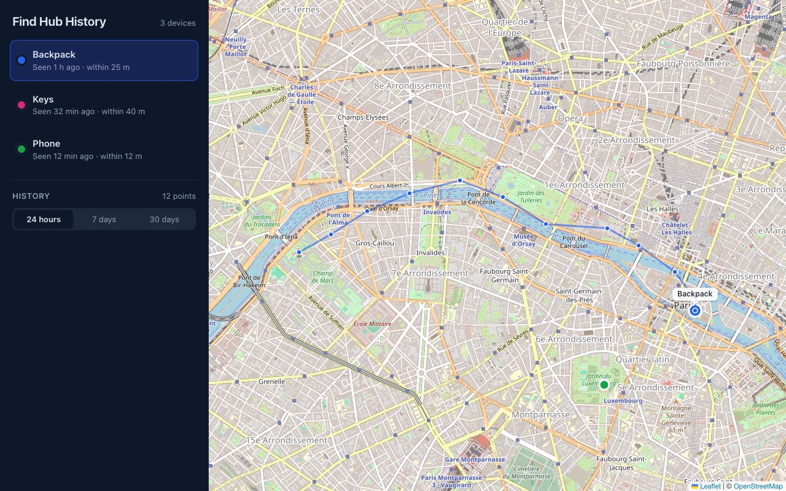

# findhub-history

Keeps a history of where your Google Find Hub devices have been, and shows it on a private map.



*The screenshot uses made-up demo data.*

## What it is, and what it is not

Google Find Hub (formerly Find My Device) only shows where each phone, tablet or tracker tag is right now.
findhub-history asks Google for those locations every 15 minutes and saves them, so you can look back at the last day, week or month.

- It does not track anything itself. Google does the tracking, exactly as it does for the Find Hub app.
- It only sees devices on your own Google account.
- It is not made by or affiliated with Google. It uses the same private interface as the Find Hub Android app, which Google can change or block at any time.
- It runs on your own server. Locations are stored there, in a SQLite file, and nowhere else.

## How it works

- `server/findhub/login/` runs once on a computer with Chrome. You sign in to Google there, and it writes a credentials file.
- `server/findhub/poll.py` uses that file to fetch every device's latest locations and stores the new ones. A systemd timer runs it every 15 minutes.
- `server/findhub/web.py` serves the stored history as read-only JSON, together with the map app in `web/`.
- `server/findhub/google/` talks to Google. It is adapted from [google-find-hub-sync](https://github.com/traccar/google-find-hub-sync).

The web app has no login of its own.
It listens on `127.0.0.1` only, and you reach it through [Tailscale](https://tailscale.com), so only devices on your tailnet can open it.

## Requirements

- A Google account with at least one device in [Find Hub](https://www.google.com/android/find/).
- A Mac with Google Chrome and Python 3.10 or newer, for the one-time sign-in. The macOS system Python is too old; install a newer one with `brew install python` or from [python.org](https://www.python.org/downloads/).
- An always-on Ubuntu server (22.04 or newer) with Python 3.10 or newer, Git, Node.js 20.19 or newer, and Tailscale.
- [HTTPS certificates enabled](https://tailscale.com/kb/1153/enabling-https) for your tailnet, so `tailscale serve` can give the app an `https://` address.

The sign-in step should also work on a Linux or Windows desktop with Chrome, but it has only been tested on a Mac.

## 1. Sign in on your Mac

```bash
git clone https://github.com/ShovonCodes/findhub-history.git
cd findhub-history/server
python3 -m venv .venv
.venv/bin/pip install '.[login]'
.venv/bin/python -m findhub.login --credentials ~/findhub-history-credentials.json
```

Chrome opens twice.
The first time, sign in to your Google account.
The second time, sign in again and unlock your end-to-end encryption keys; Google may ask for the screen lock PIN or pattern of one of your Android phones.
When it finishes, it lists the devices it found.

The credentials file gives full access to your Google account.
Keep it private, and delete your local copy once it is on the server.

## 2. Install on the Ubuntu server

Install the system packages and Node.js:

```bash
sudo apt update
sudo apt install git python3-venv
sudo snap install node --classic
```

Get the code, build it, and create a system user that owns the data:

```bash
sudo git clone https://github.com/ShovonCodes/findhub-history.git /opt/findhub-history
cd /opt/findhub-history
sudo python3 -m venv server/.venv
sudo server/.venv/bin/pip install ./server
(cd web && sudo npm ci && sudo npm run build)

sudo useradd --system --home-dir /var/lib/findhub-history --create-home --shell /usr/sbin/nologin findhub-history
sudo chmod 700 /var/lib/findhub-history
```

## 3. Copy the credentials to the server

On the Mac, replacing `server` with your server's SSH name:

```bash
scp ~/findhub-history-credentials.json server:/tmp/
rm ~/findhub-history-credentials.json
```

On the server:

```bash
sudo install -o findhub-history -g findhub-history -m 600 /tmp/findhub-history-credentials.json /var/lib/findhub-history/credentials.json
rm /tmp/findhub-history-credentials.json
```

## 4. Start it

```bash
cd /opt/findhub-history
sudo cp deploy/findhub-history-web.service deploy/findhub-history-poll.service deploy/findhub-history-poll.timer /etc/systemd/system/
sudo systemctl daemon-reload
sudo systemctl enable --now findhub-history-web.service findhub-history-poll.timer
sudo systemctl start findhub-history-poll.service
journalctl -u findhub-history-poll -n 20
```

The last command should show one line per device, such as `Keys: 3 locations received, 3 new`.

## 5. Open it through Tailscale

The web app listens on `127.0.0.1:8400`.
Publish it on your tailnet with `tailscale serve`, on an HTTPS port of your choice:

```bash
sudo tailscale serve --bg --https=8444 http://127.0.0.1:8400
```

Then open `https://<server>.<tailnet>.ts.net:8444` from any device signed in to your tailnet.
`tailscale serve status` shows the exact address.
If nothing else on the server uses `tailscale serve`, you can use `--https=443` instead and drop the port from the address.

Never use `tailscale funnel` for this app: it would put your location history on the public internet.

## Day to day

| Task | Command |
|---|---|
| See recent polls | `journalctl -u findhub-history-poll -n 50` |
| Poll right now | `sudo systemctl start findhub-history-poll` |
| See when the next poll runs | `systemctl list-timers findhub-history-poll.timer` |
| Change the interval | `sudo systemctl edit findhub-history-poll.timer`, then add `[Timer]`, an empty `OnCalendar=` line and your own, such as `OnCalendar=*:0/30` |
| Web app logs | `journalctl -u findhub-history-web -n 50` |
| Stop sharing it on the tailnet | `sudo tailscale serve --https=8444 off` |

## Updating

```bash
cd /opt/findhub-history
sudo git pull
sudo server/.venv/bin/pip install ./server
(cd web && sudo npm ci && sudo npm run build)
sudo cp deploy/*.service deploy/*.timer /etc/systemd/system/
sudo systemctl daemon-reload
sudo systemctl restart findhub-history-web
```

The poller picks up the new code on its next run.

## Troubleshooting

**The poll log asks you to run `python -m findhub.login`.**
Google ended the session, or your end-to-end encryption keys changed, for example after a password or screen lock change.
Run the sign-in step on your Mac again, and copy the new file over the old one as in steps 1 and 3.

**The map says "No trackers yet".**
The first poll has not finished yet.
Run `sudo systemctl start findhub-history-poll` and check its log.

**A device is listed but has no position.**
Google has no recent location for it.
Phones need to be online with location turned on, and tracker tags need an Android phone nearby.

**The map says it can't reach the server.**
Check `systemctl status findhub-history-web` and `journalctl -u findhub-history-web -n 50`.

**`tailscale serve` fails or the address shows a certificate error.**
Turn on MagicDNS and HTTPS certificates in the Tailscale admin console, then run the `tailscale serve` command again.

**Port 8400 is already taken.**
Change `--port 8400` in `deploy/findhub-history-web.service`, copy it to `/etc/systemd/system/` again, run `sudo systemctl daemon-reload && sudo systemctl restart findhub-history-web`, and point `tailscale serve` at the new port.

**Chrome does not open, or closes straight away, during sign-in.**
Update Chrome to the latest version and run the sign-in again.

## Privacy and security

- The credentials file is as powerful as your Google password. Anyone who has it can use your Google account. Keep it readable only by the `findhub-history` user, as the install steps do, and never commit it or back it up somewhere public.
- If the file leaks, change your Google password. That signs out every session created from it.
- The web app has no login. Anyone who can reach it sees every device and its full history. Keep it on `127.0.0.1` behind `tailscale serve`, and remember that people you share your server with on Tailscale can open it too.
- The history is stored in `/var/lib/findhub-history/findhub-history.db`. To erase it, stop both services and delete that file.
- The server only talks to Google. Your browser loads map tiles from OpenStreetMap, which therefore sees which map area you are looking at.

## Development

```bash
cd server
python3 -m venv .venv
.venv/bin/pip install -e '.[login,dev]'
.venv/bin/pytest
.venv/bin/ruff check .

FINDHUB_DB=dev.db FINDHUB_CREDENTIALS=~/findhub-history-credentials.json .venv/bin/python -m findhub.poll
FINDHUB_DB=dev.db .venv/bin/uvicorn findhub.web:app --port 8400 --reload
```

In a second terminal:

```bash
cd web
npm install
npm run dev      # proxies /api to port 8400
npm run check    # typecheck, lint and tests
```

The Python package is still called `findhub`, so its modules and environment variables (`FINDHUB_DB`, `FINDHUB_CREDENTIALS`, `FINDHUB_WEB_DIST`) keep that name.

## License and credits

Copyright © 2026 Shovon.
findhub-history is free software, released under version 3 of the [GNU General Public License](LICENSE) (`GPL-3.0-only`), the same license as the code it builds on.

- The Find Hub protocol code in `server/findhub/google/` is adapted from [google-find-hub-sync](https://github.com/traccar/google-find-hub-sync) (GoogleFindMyTools) by Leon Böttger, under the GPL-3.0. See [its notice](server/findhub/google/NOTICE.md).
- `server/findhub/google/fcm/` is [firebase-messaging](https://github.com/sdb9696/firebase-messaging) by Matthieu Lemoine and Steven Beth, under the MIT License. The license text is at the top of [its `__init__.py`](server/findhub/google/fcm/__init__.py).
- The map uses [Leaflet](https://leafletjs.com) and [React Leaflet](https://react-leaflet.js.org), with map data © [OpenStreetMap](https://www.openstreetmap.org/copyright) contributors.
